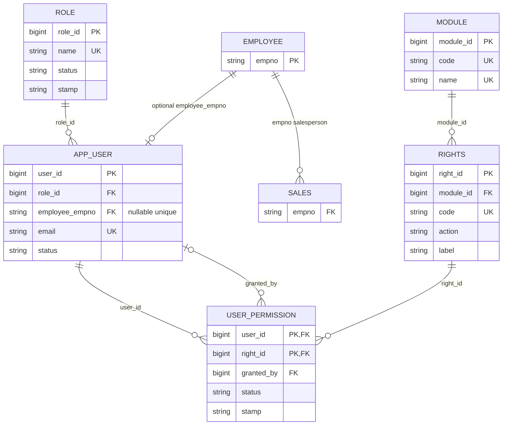

# User-management migration

## Design

| Area | Design |
|---|---|
| IDs and names | Identity `bigint` IDs; unique role/module/right codes; unique role and module names |
| Login identity | `app_user.email` is trimmed/lowercased on write, checked lowercase, and indexed uniquely case-insensitively |
| Employee link | Optional unique `app_user.employee_empno` FK; login identity is not `SALES.empno` |
| Permission lifecycle | Composite `(user_id, right_id)` key; `Inactive` preserves a row; re-grant reactivates it |
| Authorization | Superadmin gets active rights implicitly; application checks Admin/Superadmin before grant/revoke; a database trigger also checks the transaction actor |
| Effective rights | `v_user_effective_rights` returns each active catalogue right for a user with a `granted` boolean; indexed active assignments support the lookup |

## ERD fragment



`SALES.empno` records the employee who made a sale. `app_user` is the
authenticated login/actor identity. `employee_empno` is an optional,
one-to-one link when a login belongs to an employee; administrators or
service accounts may have no employee link. Audit actor identity should use
`app_user.user_id` (or its authenticated identity), not infer the actor from
`SALES.empno`.

## Authorization and soft-delete behavior

The application must authorize every grant/revoke request server-side using
the authenticated actor's current, active, unblocked role. Only Admin and
Superadmin may manage assignments. In the same database transaction, the
trusted server sets `SET LOCAL app.actor_user_id = '<authenticated user_id>'`
before changing `user_permission`. The migration trigger verifies that user
and role, records `granted_by`, and rejects physical DELETE. Never expose
direct write credentials to clients: a custom PostgreSQL setting is a
database guardrail, not proof of identity if arbitrary SQL access is granted.

Superadmin receives every active catalogue right implicitly in
`v_user_effective_rights`; no `user_permission` rows are required. A blocked
user's assignment rows remain unchanged, but `granted` is false while blocked.

Unticking a right sets its existing row to `Inactive`. Re-ticking changes that
same row back to `Active` and refreshes `granted_by`, `granted_at`, and `stamp`.
The stamp contains only the latest action; repeated toggles overwrite it, so
the full history of grants/revocations is lost unless Task 6 audit logging is
added.

## Verification queries and expected results

Run after `npm run db:migrate` against a fresh development database:

```sql
SELECT name FROM role WHERE status = 'Active' ORDER BY name;
-- Admin, Superadmin, User

SELECT module_name, active_right_count
FROM v_module_right_counts
ORDER BY module_code;
-- Customer 3, Human Resources 13, Product 6, Reports 7, Sales 7

SELECT count(*) AS active_catalogue_rights
FROM rights
WHERE status = 'Active';
-- 36

SELECT count(*) AS lowercase_email_violations
FROM app_user
WHERE email <> lower(email);
-- 0 (and uppercase input is normalized by the trigger)

SELECT count(*) AS active_permission_index
FROM user_permission
WHERE status = 'Active';
-- 0 on the fresh migration database

SELECT count(*) AS orphan_user_permissions
FROM user_permission up
LEFT JOIN app_user u ON u.user_id = up.user_id
LEFT JOIN rights r ON r.right_id = up.right_id
LEFT JOIN app_user g ON g.user_id = up.granted_by
WHERE u.user_id IS NULL OR r.right_id IS NULL OR g.user_id IS NULL;
-- 0
```

New users inserted without `role_id` receive the active `User` role. New
installs start with no app-user accounts or permission assignments; create the
first Superadmin through a trusted, one-time administrative provisioning
process before using the grant trigger.
